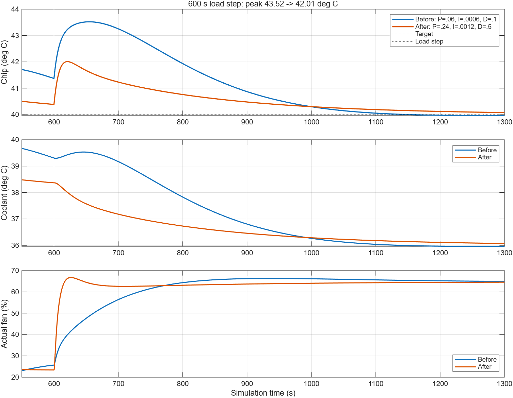

# Liquid Cooling Control for AI Servers

> Simulink/Simscape thermal-fluid modeling + Arduino hardware test rig + RL-based cooling control.
> A portfolio project: from simulation to hardware (sim-to-real).

## Phase A results and quick start

The first simulation milestone is implemented: a two-node **Simscape Thermal** plant
with a Simulink PID fan controller. This is a fixed-flow thermal approximation;
the Thermal Liquid pipe, pressure and pump model, MPC and hardware validation are future work.

- [Complete English report](docs/Phase_A_Report.md)
- [Word report](docs/Phase_A_Report.docx)
- [Configuration snapshot](config/phase_a_config.json)
- [Simulink model with tuned PID](sim/liquid_cooling_phase_a.slx)
- [Step-by-step tuning metrics](sim/pid_tuning_metrics.csv)

Tested in MATLAB R2026a with Simulink and Simscape. No hardware is needed.
From the repository root, run:

```matlab
addpath(fullfile(pwd,'sim'));
setup_phase_a;
open_system(fullfile(pwd,'sim','liquid_cooling_phase_a.slx'));
```

Click **Run**, then open **Scope**. The saved model uses `P=0.24`, `I=0.0012`,
`D=0.5`, `N=1`, with output limits 0 to 1 and clamping anti-windup.
To reproduce all experiments, including the original baseline, run `run_all_phase_a`.
This resets teaching defaults, reruns comparisons, overwrites generated result files,
and leaves the tuned controller in the model. Close parameter dialogs before running scripts.

| 20 W to 40 W at 600 s | Baseline PID | Tuned PID |
| --- | ---: | ---: |
| Peak chip temperature after load step | 43.52 C | 42.01 C |
| Peak excursion above 40 C | 3.52 C | 2.01 C |
| Recovery into 40 +/- 0.2 C after step | 429.7 s | 488.1 s |

Peak excursion is reduced by about 42.9%, with a roughly 58 s longer recovery in
the original cold-start experiment. With a settled 20 W starting point, peaks are
42.81 C and 41.68 C, respectively. All plant parameters are teaching assumptions.



## What this is

A desktop-scale liquid cooling loop that mimics direct-to-chip cooling for AI servers:
heater cartridge (40 W) plays the role of the compute chip, a water block + 120 mm
radiator + pump form the cooling loop, and an Arduino closes the loop —
reading temperatures and driving pump/fan/heater via PWM.

The end goal: a controller that holds chip temperature under varying compute load,
first designed in simulation, then validated on real hardware —
and finally an RL agent trained in simulation and deployed to the rig
(the same idea Meta uses for data-center cooling optimization).

## System architecture

Reservoir -> Pump -> Cold plate (+ 40W heater = "chip") -> Radiator + Fan -> back to reservoir.
Arduino UNO R4 reads 3x DS18B20 temp sensors and drives pump/fan/heater via MOSFET PWM drivers.
PC runs MATLAB/Simulink in External Mode for tuning and monitoring.

## Roadmap

- Phase A — Simulation: Simscape thermal-fluid plant model; PID to MPC controller comparison in simulation.
- Phase B — Hardware rig: build the Arduino test rig; hardware-in-the-loop validation; sim-vs-hardware calibration.
- Phase C — RL control: train an RL agent (Reinforcement Learning Toolbox) in simulation; deploy to hardware; sim-to-real comparison.

## Hardware (~$305 incl. Arduino UNO Q for side projects)

Arduino UNO R4 WiFi (rig controller) x1; Arduino UNO Q 4GB (side projects) x1;
DS18B20 waterproof temp sensor x3; IRF520 MOSFET driver module x3;
12V 5A power supply x1; 12V mini brushless submersible pump x1;
12V 40W heater cartridge (6x20mm) x1; copper CPU water block G1/4 x1;
120mm radiator + 120mm high-static-pressure fan; silicone tubing 8mm ID 2m;
G1/4 barb fittings x4; thermal paste, breadboard, dupont wires.

## Repo layout

sim/ — Simulink/Simscape models (Phase A)
hardware/ — Arduino wiring, BOM, rig photos (Phase B)
rl/ — RL training scripts and deployed policy (Phase C)
docs/ — notes, sim-vs-hardware comparisons

## Status

- Project scoped and BOM finalized (Oct 2026)
- Hardware ordered after house move (Oct 23, 2026)
- Phase A: minimal Simscape Thermal plant, PID baseline, fixed-fan comparison and five-step PID tuning completed in simulation
- Next in Phase A: noise and parameter robustness, Thermal Liquid flow model, and MPC comparison
- Phase B: rig build + HIL validation
- Phase C: RL sim-to-real
