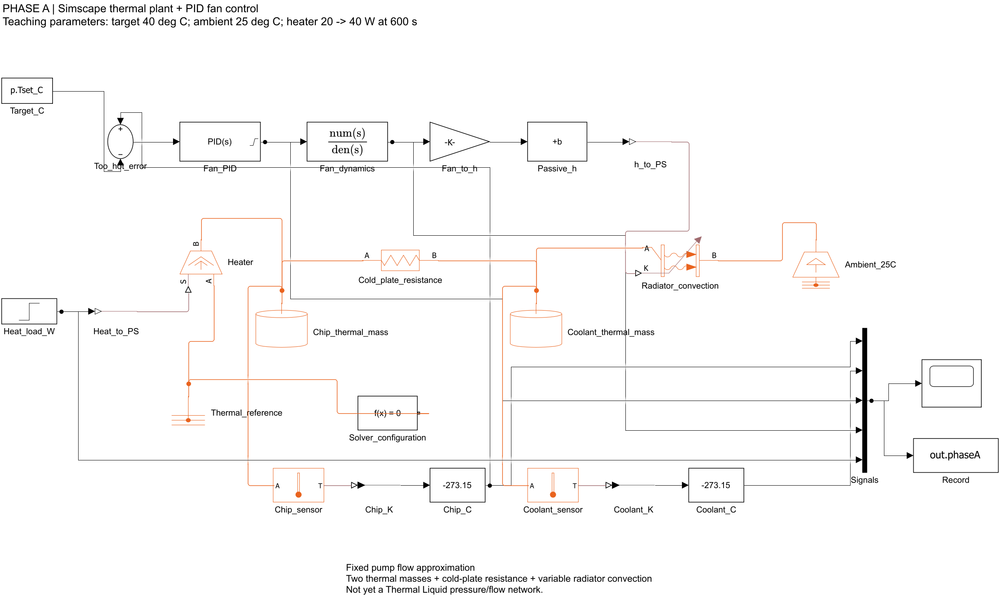
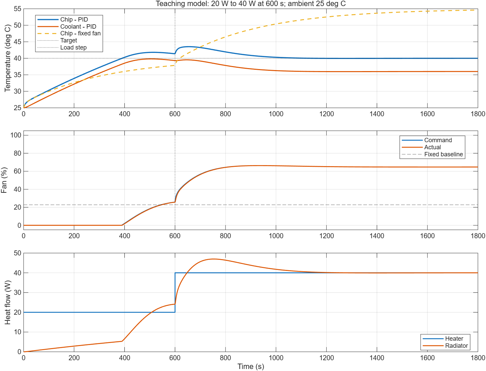
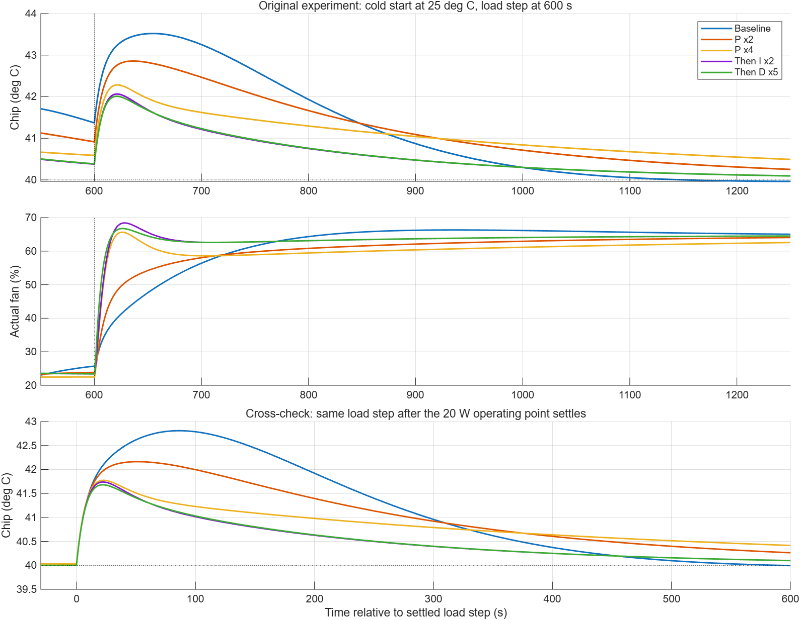

# Liquid Cooling Control Phase A Report

MATLAB Simulink and Simscape closed loop modeling and PID tuning

Repository: Jaaron0414/liquid-cooling-control    Recorded: 15 October 2026

## Results

We built a minimal thermal plant with chip and coolant heat storage, cold plate heat transfer, radiator convection, fan dynamics and PID feedback. When heater power rises from 20 W to 40 W at 600 s, tuning reduces peak chip temperature from 43.52°C to 42.01°C. The peak excursion above the 40°C target falls from 3.52°C to 2.01°C, a reduction of about 42.9%.

There is a tradeoff: recovery into 40 ± 0.2°C takes about 430 s with the baseline and 488 s with the selected gains in the original cold start experiment. A separate experiment starts the load step after the system has settled and confirms that the peak reduction is not only a startup effect.

| Setting | Value |
| --- | --- |
| Tested software | MATLAB R2026a Update 5 |
| Required products | MATLAB, Simulink and Simscape |
| Target and ambient | Chip 40°C; ambient 25°C |
| Load and duration | 20 to 40 W at 600 s; stop at 1800 s |
| Baseline PID | P = 0.06; I = 0.0006; D = 0.1 |
| Saved tuned PID | P = 0.24; I = 0.0012; D = 0.5 |
| Controller settings | Continuous parallel; N = 1; output 0 to 1; clamping |
| Solver | ode23t; maximum step 1 s; relative tolerance 1e-5 |

## Model scope

This is a two node lumped Simscape Thermal model at assumed fixed pump flow. It does not yet model Thermal Liquid pipes, pressure, mass flow, pump curves or transport delay. Plant parameters and the fan mapping are teaching assumptions, not calibrated hardware measurements. These results establish simulation behavior, not hardware performance or safety.

## 1 Heat flow and model structure

The heater injects power into the chip node. Heat passes through an equivalent cold plate resistance into the coolant, then through a variable convection radiator to the 25°C environment. The PID uses measured chip temperature to calculate a fan command.



$$
Q_{cw}=\frac{T_{chip}-T_{water}}{R_{cw}}
$$

$$
Q_{rad}=(G_0+G_f u)(T_{water}-T_{ambient})
$$

$$
C_{chip}\frac{dT_{chip}}{dt}=Q_{heater}-Q_{cw}
$$

$$
C_{water}\frac{dT_{water}}{dt}=Q_{cw}-Q_{rad}
$$

Orange connections are Simscape thermal conserving connections carrying temperature and heat flow constraints. Black connections carry Simulink numerical signals. A PS-Simulink Converter outputs sensor temperature in kelvin; subtracting 273.15 gives degrees Celsius. Simulink-PS Converters pass heater power and the convection coefficient into the physical network.

Thermal Reference defines the absolute temperature reference; it is not the 25°C environment. A separate Temperature Source sets the environment to 298.15 K. Each independent Simscape network needs a Solver Configuration block.

## 2 Thermal capacity and cold plate resistance

### Thermal capacity controls the rate of temperature change

Thermal capacity C equals mass m times specific heat cp. It is the energy needed to increase temperature by 1 K. The chip node represents the effective inertia of the heater and cold plate; the coolant node represents a well mixed effective liquid inventory.

| Node | Mass kg | Specific heat J/(kg K) | Capacity J/K |
| --- | --- | --- | --- |
| Chip and cold plate | 0.16 | 500 | 80 |
| Coolant | 0.10 | 4180 | 418 |

If heat transfer out of the chip were temporarily ignored, 20 W would warm its 80 J/K capacity at 0.25°C/s. Actual warming depends on net power: heater input minus heat leaving the chip.

### Resistance relates temperature difference to heat flow

Cold_plate_resistance connects the chip at port A and coolant at port B. Its resistance is 0.1 K/W. Heat flows from the hotter side to the cooler side; equal temperatures give zero net heat flow. A resistance of 0.1 K/W means each watt of heat flow requires a 0.1°C temperature difference. Temperature differences have the same numerical value in kelvin and Celsius.

| Heat flow W | Required temperature difference °C |
| --- | --- |
| 10 | 1 |
| 20 | 2 |
| 40 | 4 |

At a chip temperature of 40°C and water temperature of 36°C, heat flow is (40 − 36)/0.1 = 40 W. Doubling resistance to 0.2 K/W would require an 8°C difference for the same heat flow. Lower resistance makes heat transfer easier.

This equivalent resistance combines contact interfaces, cold plate conduction and liquid heat transfer. It is not just a material property. Flow rate, contact pressure and thermal interface material affect the resistance in hardware.

### Enable the initial temperature target

Both Thermal Mass blocks start at 298.15 K with T_specify set to on and priority High. Entering a temperature without enabling its initial target does not ensure it will be used during initialization. The saved data were checked to start both nodes at 25°C.

## 3 Radiator convection and fan dynamics

### Variable convection

Radiator_convection uses variable convection with equivalent area A = 0.1 m². Its hot side connects to coolant and its cold side to the 25°C environment. Liquid to wall, fin and air heat transfer are combined into one equivalent block. Port K receives the coefficient h, not temperature or fan speed.

$$
Q_{rad}=hA(T_{water}-T_{ambient})
$$

$$
h=4+50u_{actual},\quad 0\le u_{actual}\le1
$$

Faster airflow increases heat transfer capacity at a given temperature difference. With the fan off, passive conductance is 0.4 W/K; full fan adds 5 W/K. The block minimum coefficient of 1e-3 W/(m² K) is a lower bound; normal h ranges from 4 to 54 W/(m² K).

| Actual fan speed | h W/(m² K) | Heat rejection at water 36°C W |
| --- | --- | --- |
| 0% | 4 | 4.4 |
| 50% | 29 | 31.9 |
| 100% | 54 | 59.4 |

These values use a fixed 11°C temperature difference. Fan speed changes cooling capacity, not a directly prescribed heat flow. With zero temperature difference this block transfers no net heat. A fan and radiator alone cannot sustain coolant below ambient temperature.

### A two second first order response

$$
\frac{u_{actual}(s)}{u_{command}(s)}=\frac{1}{2s+1}
$$

Fan_dynamics has numerator 1 and denominator [p.tauFan 1], with tauFan = 2 s. Its rate of change is the command minus actual speed, divided by 2. Here s is the Laplace variable and 2 s is the time constant.

| Time after a command step | Fraction of speed change completed |
| --- | --- |
| 2 s | 63.2% |
| 4 s | 86.5% |
| 6 s | 95.0% |
| 10 s | 99.3% |

For a change from 20% to 80%, speed reaches about 57.9% after 2 s. It approaches 80% if the command stays fixed. These percentages are normalized speed, not a calibrated RPM or PWM duty cycle.

## 4 How PID regulates chip temperature

$$
e=T_{chip}-40
$$

The error is chip temperature minus the target. A hot chip gives positive error, so the controller increases fan command and creates cooling feedback. The controller uses continuous parallel form.

$$
C(s)=P+\frac{I}{s}+D\frac{Ns}{s+N}
$$

### Proportional gain P

P responds immediately to current error. With baseline P = 0.06 and a chip at 42°C, the 2°C error contributes 0.12, or 12 percentage points, to fan command. Integral and filtered derivative contributions are added to obtain the total. Increasing P strengthens response to a given error, but also changes damping, recovery and sensitivity to noise.

### Integral gain I

I accumulates persistent error to build the command needed for thermal balance. At I = 0.0006, a constant 2°C error for 10 s adds 0.012, or 1.2 percentage points, provided anti-windup does not intervene. The integral can retain its value when error reaches zero. At the 40 W equilibrium, P and D tend toward zero while the integral maintains about 64.73% fan command.

### Derivative gain D and filter N

With a fixed target, error rate equals chip temperature rate. D tends to increase the fan command during rapid warming and reduce it during cooling. It reacts to the present trend; it has no advance knowledge of the heater load. N = 1 per second filters the derivative, so this term differs from an ideal unfiltered derivative.

### Output limits and anti windup

Fan_PID limits output to 0 through 1 and uses clamping anti-windup. When output is at a limit and integration would push it further into saturation, the controller suppresses that integral accumulation to help recovery.

| Gain | Baseline | Saved tuned model |
| --- | --- | --- |
| P | 0.06 | 0.24 |
| I | 0.0006 | 0.0012 |
| D | 0.1 | 0.5 |
| N | 1 | 1 |

## 5 Baseline and fixed fan comparison



Both nodes start at 25°C. The fan initially stays off below the target, then increases after the chip exceeds 40°C. Startup has not fully settled by 600 s: chip temperature is 41.37°C, coolant 39.31°C and actual fan speed 25.73%.

At 600 s, heater power jumps from 20 W to 40 W. Temperature remains continuous, but its rate changes immediately. PID receives temperature feedback, not the heater load. The baseline chip peaks at 43.52°C around 654.4 s, then cools as fan output increases. Final values are about 40.00°C chip, 36.00°C coolant and 64.72% fan speed.

The fixed fan comparison holds the approximately 22.77% command needed at the 20 W equilibrium. After the load doubles, chip temperature reaches 54.61°C at 1800 s. This finite time value is not the exact steady state; the calculated equilibrium is 55°C.

Coolant ends colder at higher load because the chip target is fixed: 20 W requires a 2°C cold plate difference and 38°C water; 40 W requires 4°C and 36°C water. The baseline numerical energy residual is about 0.0001 J, a simulation consistency check rather than hardware validation.

## 6 Tuning one parameter at a time

The plant, two second fan lag, N = 1, output limits and 25°C initial conditions stay fixed. Each row changes only one gain from the previous row. The load step occurs at 600 s and the simulation stops at 1800 s.

| Step | P | I | D | Peak °C | Recovery s |
| --- | --- | --- | --- | --- | --- |
| Baseline | 0.06 | 0.0006 | 0.1 | 43.52 | 429.7 |
| Double P | 0.12 | 0.0006 | 0.1 | 42.86 | 705.9 |
| Double P again | 0.24 | 0.0006 | 0.1 | 42.28 | 1075.3 |
| Double I | 0.24 | 0.0012 | 0.1 | 42.06 | 489.1 |
| Increase D fivefold | 0.24 | 0.0012 | 0.5 | 42.01 | 488.1 |

Recovery is measured from the load step until chip temperature enters 40 ± 0.2°C and stays there through the simulation end. This finite observation is not a proof of stability for all future time.

### P reduces the peak but can lengthen recovery

Increasing P from 0.06 to 0.24 makes fan output rise earlier and lowers the peak. With I unchanged, however, the slow tail becomes longer in this example. Peak temperature alone is therefore insufficient for selecting gains.

### I improves recovery for this gain combination

At P = 0.24, doubling I to 0.0012 builds the output needed for the new load faster and shortens recovery from 1075 s to 489 s. This does not mean increasing I always reduces overshoot; excessive integration can still cause oscillation and saturation.

### D gives a small additional improvement

Increasing D from 0.1 to 0.5 lowers the peak by only about 0.054°C and reduces peak actual fan speed from 68.39% to 66.74%. The present model has no measurement noise, so it does not establish that the larger D is better with real sensors.

### Selected gains and tradeoff

The saved model uses P = 0.24, I = 0.0012 and D = 0.5. Peak excursion falls 42.9%, with recovery about 58 s slower in this cold start experiment. Five candidates illustrate tuning; they do not establish a global optimum. Final chip temperature is 40.0075°C and fan speed about 64.71%.

## 7 Curve comparison and settled start check



Different gains also change startup, giving different temperatures at 600 s. To separate this effect, each controller is run at 20 W until 1800 s, then stepped to 40 W and simulated until 3000 s. The lower panel sets time zero at that later load step.

With a settled starting condition, baseline and tuned peaks are 42.809°C and 41.680°C; recovery times are 453.3 s and 449.8 s. The peak reduction persists, supporting the conclusion that it is not only caused by different startup states.

## 8 Before and after results and saved files


After the load increase, the tuned fan command rises faster and coolant cools earlier, reducing the chip peak. Beyond about 1000 s, its temperature tail is slightly higher than baseline, consistent with longer recovery in this experiment. Both fan speeds approach the same roughly 64.73% thermal equilibrium because the plant and target are unchanged.

| File | Purpose |
| --- | --- |
| sim/liquid_cooling_phase_a.slx | Model with selected PID |
| sim/liquid_cooling_phase_a_before_tuning.slx | Baseline model backup |
| sim/pid_tuning_trials.mat | Full traces for both experiment types |
| sim/pid_tuning_metrics.csv | Gains and performance metrics |
| config/phase_a_config.json | Environment and configuration snapshot |

## 9 Reproducing the experiments

Set the MATLAB current folder to the repository root. The selected parameters are saved in model workspace variable p inside the SLX file. Close or apply any parameter dialogs before running scripts so pending edits do not block simulation.

### Open the saved model and Scope

```matlab
addpath(fullfile(pwd,'sim'));
setup_phase_a;
open_system(fullfile(pwd,'sim','liquid_cooling_phase_a.slx'));
view_phase_a_scope;
```

Scope groups chip and coolant temperatures, commanded and actual fan percentages, and heater power into three plots.

### Reproduce all results

```matlab
run_all_phase_a;
```

This entry restores baseline teaching defaults, runs PID and fixed fan comparisons, runs five gain trials with both load step schedules, then applies the selected gains and displays Scope and comparison plots. It overwrites generated results and leaves the model tuned. setup_phase_a directs cache files to ignored repository folders.

### Restore or apply gains

```matlab
update_phase_a_parameters;  % Restore baseline
apply_phase_a_pid_tuning;   % Apply selected gains and simulate
```

phase_a_parameters.m retains baseline defaults. After editing it, call update_phase_a_parameters to copy values into the model workspace. The JSON file is a snapshot and is not automatically loaded. build_phase_a creates a model from scratch and stops if the same model already exists or is open, protecting manual edits.

### Requirements and validation

Tested in MATLAB R2026a Update 5 with Simulink and Simscape. This minimal model does not require Simscape Fluids, Control System Toolbox or Reinforcement Learning Toolbox. Older MATLAB releases were not tested. The repository entry was rerun successfully; initial temperatures, finite signals, output limits, thermal balance and saved gains were checked. See config/validation.txt.

### Next experiments

Add sensor sampling, noise and lag to assess D and filtering, then vary capacity, resistance and ambient temperature. Calibrate against measured step data before adding Thermal Liquid pumps and pipes, actuator PWM mapping, MPC and reinforcement learning comparisons. Hardware deployment and protection validation remain future work.

### Data and references

Results come from the saved MATLAB simulation data. Full metrics are in sim/pid_tuning_metrics.csv. Block definitions are documented by MathWorks under Thermal Mass, Thermal Resistance, Convective Heat Transfer, Transfer Fcn and PID Controller.

MathWorks documentation: [Thermal Mass](https://www.mathworks.com/help/simscape/ref/thermalmass.html), [Thermal Resistance](https://www.mathworks.com/help/simscape/ref/thermalresistance.html), [Convective Heat Transfer](https://www.mathworks.com/help/simscape/ref/convectiveheattransfer.html), [Transfer Fcn](https://www.mathworks.com/help/simulink/slref/transferfcn.html), [PID Controller](https://www.mathworks.com/help/simulink/slref/pidcontroller.html).
